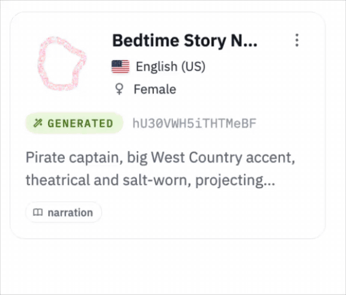

<p align="center">
  <a href="https://gradium.ai/phonon"></a>
</p>

Phonon brings natural text-to-speech to phones, laptops, browsers, and local
services. It is built for offline assistants, accessibility tools, and
interactive experiences that need speech without a cloud round trip. The runtime
is written in Rust and needs no PyTorch.

<p align="center">
  <a href="https://github.com/gradium-ai/xn-ptts/actions/workflows/rust-ci.yml"></a>
  <a href="https://github.com/gradium-ai/xn-ptts/actions/workflows/maturin-pub.yml"></a>
  <a href="https://github.com/gradium-ai/xn-ptts/actions/workflows/npm-publish.yml"></a>
  <a href="https://github.com/gradium-ai/xn-ptts/actions/workflows/cli-release.yml"></a>
  <a href="https://github.com/gradium-ai/xn-ptts/actions/workflows/docker.yml"></a>
</p>

<p align="center">
  <a href="#license"></a>
  <a href="https://discord.gg/T85yt8kD33"></a>
</p>

<p align="center">
  <a href="https://crates.io/crates/ptts"></a>
  <a href="https://pypi.org/project/ptts/"></a>
  <a href="https://www.npmjs.com/package/phonon-tts"></a>
  <a href="https://github.com/gradium-ai/xn-ptts/releases"></a>
  <a href="#swift"></a>
  <a href="#android"></a>
</p>

<p align="center">
  <a href="#try-it">[1]&nbsp;TRY&nbsp;IT</a>&nbsp;&nbsp;&nbsp;
  <a href="#what-you-get">[2]&nbsp;WHAT&nbsp;YOU&nbsp;GET</a>&nbsp;&nbsp;&nbsp;
  <a href="#choose-an-integration">[3]&nbsp;INTEGRATIONS</a>&nbsp;&nbsp;&nbsp;
  <a href="#voices">[4]&nbsp;VOICES</a>&nbsp;&nbsp;&nbsp;
  <a href="#quickstart">[5]&nbsp;QUICKSTART</a>&nbsp;&nbsp;&nbsp;
  <a href="#examples">[6]&nbsp;EXAMPLES</a>&nbsp;&nbsp;&nbsp;
  <a href="#guides">[7]&nbsp;GUIDES</a>
</p>


## Try it

With [uv](https://docs.astral.sh/uv/), one line writes a WAV:

```sh
uvx ptts --lang en "Hello from Phonon." -o speech.wav
```

The first run downloads the default model and caches it. See [Model
setup](#model-setup) to use another model.

## What you get

- **Small enough to ship:** Choose Phonon 31m or Phonon 40m. Each can ship
  inside a mobile app or load in a browser tab.
- **Five languages:** Speak English, French, German, Spanish, and Portuguese,
  with more languages available on request.
- **Fast across devices:** A custom inference stack runs in browsers and on
  phones, laptops, and embedded hardware, with Core ML on Apple devices, QNN on
  supported Snapdragon NPUs, and GPU support. Multiple backends
  deliver faster inference than Kokoro and llama.cpp-based runtimes on the same
  hardware.
- **Voices ready to use or make your own:** Choose from ready-to-use voices, or
  design or clone your own and bring it to your device with [two
  scripts](#voices).
- **Control the delivery:** Set the speaking rate with the `duration_delta`
  condition, and start playing streamed audio before the full utterance is ready.

## Performance

Two model sizes, one inference stack. Each cell is how many seconds of audio Phonon makes per
second of compute (higher is faster; above 1x is faster than real time) and the time to first
byte (TTFB). CPU rows use the number of cores shown; the Neural Engine row runs on the accelerator.

| Device | Phonon 31m | Phonon 40m |
|---|---|---|
| MacBook Air M5, CPU + KleidiAI, 1 core | 26x · 5 ms | 20x · 7 ms |
| MacBook Air M5, CPU + KleidiAI, 4 cores | 41x · 6 ms | 39x · 8 ms |
| iPhone 16 Pro, Neural Engine | 22x · 9 ms | 20x · 12 ms |
| Raspberry Pi 5, CPU, 1 core | 2.3x · 68 ms | 2.2x · 88 ms |

- TTFB stays under 20 ms on Apple devices, because Phonon streams frame by frame instead of waiting
  for the whole sentence.
- On one MacBook Air core, Phonon 40m reaches 20x real time with a 7 ms TTFB. Kokoro (82M), through
  its own PyTorch package on the same core, reaches 7.3x with a 776 ms TTFB, since it makes the whole
  sentence before returning any audio.

## Choose an integration

Each goal links to its quickstart below.

| You want to… | Package | Get it | Details |
|---|---|---|---|
| [Generate a speech file](#command-line) | Desktop `ptts` command | [GitHub Releases](https://github.com/gradium-ai/xn-ptts/releases) or [Homebrew tap](https://github.com/gradium-ai/homebrew-tap) | Linux x64/ARM64, Mac Apple silicon/Intel, and Windows x64 archives, with checksums. No Python or Rust needed. [CLI guide](docs/cli.md). |
| [Add speech to a script or backend](#python) | Python `ptts` | [PyPI](https://pypi.org/project/ptts/) | Wheels for supported platforms; CPython 3.9+. [Python guide](ptts-pyo3/README.md). |
| [Run speech in a web app](#browser) | `phonon-tts` | [npm](https://www.npmjs.com/package/phonon-tts) | Worker, single-thread and threaded Wasm builds, and TypeScript declarations. [Browser guide](ptts-wasm/js/README.md). |
| [Add speech to an iPhone or Mac app](#swift) | Swift `ptts` | Swift Package Manager: `https://github.com/gradium-ai/xn-ptts.git`, or [GitHub Releases](https://github.com/gradium-ai/xn-ptts/releases) | The package at each release tag, or `ptts-swift-<version>.zip`, with its matching compiled framework. Needs a Core ML model bundle: the release has one for Phonon 31m, or export your own. [Swift guide](ios/PhononTTS/README.md). |
| [Add speech to an Android app](#android) | Android `ptts` (QNN) | [QNN Android guide](qnn/android/README.md) | Kotlin API and AAR for supported Snapdragon NPUs. Not published to Maven Central yet. |
| | Android CPU library | [Build guide](android/README.md#1-build-the-library) | `libptts_ffi.so` and a Kotlin wrapper, built from source with Rust and the Android NDK. |
| [Give Home Assistant's voice assistant a local voice](ptts-openai-server/README.md#home-assistant) | Home Assistant app | [phonon-home-assistant](https://github.com/gradium-ai/phonon-home-assistant) | App for Home Assistant OS that runs the server image and connects it to your voice assistants. No custom integration. |
| [Connect an existing app or self-host](#docker-and-openai-compatible-api) | `ptts-openai-server` | `ghcr.io/gradium-ai/ptts-openai-server:<version>` | CPU image for amd64 and arm64; it downloads the default model on first start, or mounts your own. [Server guide](ptts-openai-server/README.md). |
| [Embed the runtime in Rust](#rust) | Rust `ptts` | [crates.io](https://crates.io/crates/ptts) | Library API; add the `cli` feature to install the command. [Rust guide](ptts/README.md). |
| [Call Phonon from C, C++ or another language](#c) | C library | [Build guide](ptts-ffi/README.md#1-build-the-library) | `ptts.h` and `libptts_ffi`, built from source with Rust, for Linux, Windows, macOS, iOS and Android. Works from any language that can call C. [C guide](ptts-ffi/README.md). |

The packages are named **`ptts`**, except the npm package **`phonon-tts`**; Swift apps `import PhononTTS`.

## Model setup

Without a model argument, the command line, Python, the browser package, the servers and Rust download the default model from Hugging Face on first use and cache it. The default is Phonon 31m, [`hf://gradium/phonon-31m-en`](https://huggingface.co/gradium/phonon-31m-en), pinned to one commit. Swift, Android and the C library load a model folder you supply.

The Phonon models on Hugging Face:

| Model | Hugging Face repo | Languages | License |
|---|---|---|---|
| Phonon 31m | [`gradium/phonon-31m-en`](https://huggingface.co/gradium/phonon-31m-en) | English | Apache 2.0 |
| Phonon 40m | `gradium/phonon-40m-`[`en`](https://huggingface.co/gradium/phonon-40m-en), [`fr`](https://huggingface.co/gradium/phonon-40m-fr), [`de`](https://huggingface.co/gradium/phonon-40m-de), [`es`](https://huggingface.co/gradium/phonon-40m-es), [`pt`](https://huggingface.co/gradium/phonon-40m-pt) | English, French, German, Spanish, Portuguese: one model each | CC BY-NC 4.0 |
| Phonon 40m multilingual | [`gradium/phonon-40m-multilingual`](https://huggingface.co/gradium/phonon-40m-multilingual) | the same five, in one model | CC BY-NC 4.0 |

Phonon 31m is public. The Phonon 40m models are gated. To use one, accept its terms on its Hugging Face page; approval is automatic. Then set `HF_TOKEN` or run `hf auth login`, and the command line, Python, the servers and Rust download it like any other model. The browser package has no token to send, so it loads only Phonon 31m from Hugging Face. To use a Phonon 40m model in a browser, download its files and serve them with your app, under the model's license.

To use another model, pass a Hugging Face repo as `hf://OWNER/MODEL`, adding a commit as `hf://OWNER/MODEL@COMMIT_SHA` for a repeatable version, or a local checkpoint folder. Private repos also need `HF_TOKEN` or a saved HF login. Local folders require no Hub access.

## Voices

Each checkpoint comes with a default voice. The voice catalog
[`gradium/phonon-voices`](https://huggingface.co/gradium/phonon-voices) has
many more, in every language Phonon speaks. When a checkpoint does not have the
voice you ask for, the command line and Python look it up there and download
only that voice. The servers serve the catalog's voices in their language. `ptts
--list-voices` lists the catalog with each voice's language. Pick a voice in the
language of your text.

```sh
ptts --lang en --voice Zoey "Hello from Phonon." -o speech.wav
```

### Download a voice from Gradium Studio

<table>
<tr>
<td width="50%">

</td>
<td>

1. Sign in to [Gradium Studio](https://studio.gradium.ai/).
2. Design a voice in **Voice Design**, or open one of your custom voices in the **catalog**.
3. Click **⋮** on the voice, then **Download for Phonon**.

Pass the file you get to `--voice` of the desktop `ptts` command, or to `tts.add_voice` in Python. It works with every Phonon checkpoint.

</td>
</tr>
</table>

You can also design a voice from a
text description in [Gradium Studio](https://studio.gradium.ai/), or clone one
from a short recording, and download it from the command line. Two scripts download these voices as voice files. They
need [uv](https://docs.astral.sh/uv/) and a Gradium API key, which you can
create in Gradium Studio. The voice files work with every Phonon checkpoint.
Run the scripts from a clone of this repository, or pass their URL to `uv run`,
for example `uv run https://raw.githubusercontent.com/gradium-ai/xn-ptts/main/scripts/download-voice.py --list`.

```sh
export GRADIUM_API_KEY=...

# List your voices, with their IDs
uv run scripts/download-voice.py --list

# Download a voice you designed or cloned, by ID
uv run scripts/download-voice.py VOICE_ID -o voice.safetensors

# Clone a voice from a recording; 10 seconds of clear speech are used
uv run scripts/clone-voice.py speaker.wav --lang en -o voice.safetensors

ptts --lang en --voice voice.safetensors "Hello from Phonon." -o speech.wav
```

A voice file path works with the desktop `ptts` command; the Python command takes voice names only. In Python, register the file with `tts.add_voice("NAME", "voice.safetensors")`. To use it by name in the servers too, save it in a local checkpoint folder's `voices/`: `-o model/voices/NAME.safetensors` adds the voice `NAME`. A cloned voice is also saved in your Gradium account, so `download-voice.py` can fetch it again by the ID `clone-voice.py` prints. Clone a voice only with the speaker's consent.


## Quickstart

These examples use the default model.

### Command line

<details>
<summary>Show command line quickstart</summary>

On Mac or Linux, install the prebuilt desktop command from Gradium's Homebrew
tap:

```sh
brew install gradium-ai/tap/ptts
```

You can also extract a [desktop archive](docs/cli.md) and put `ptts` on your
`PATH`. Neither path needs Python or Rust. Generate a mono 24 kHz WAV:

```sh
ptts --lang en "Hello from Phonon." -o speech.wav
```

Use `--model` for another model (see [Model setup](#model-setup)), `--quant q8` for faster q8 weights on the CPU, and `--voice NAME` to choose a voice, from the model or the [voice catalog](#voices); omitting it uses the model's default voice. Run `ptts --help` for the remaining options. [CLI guide →](docs/cli.md)

</details>

### Python

<details>
<summary>Show Python quickstart</summary>

Install the Python package into your environment:

```sh
python -m pip install ptts
```

Then save speech in four lines:

```python
import ptts

tts = ptts.TTS(lang="en")
tts.save("speech.wav", "Hello from Phonon.")
```

Reuse `tts`. `tts.synth(text)` returns a float32 NumPy array; `tts.stream(text)` yields audio chunks:

```python
with tts.stream("Speech can play while the rest is being generated.") as audio:
    for pcm in audio:
        # Send each chunk to your player at audio.sample_rate.
        print(pcm.shape)
```

Leaving the `with` block stops generation and releases its workers. To use another model, pass a local folder or a Hugging Face repo as the first argument, for example `ptts.TTS("hf://gradium/phonon-40m-fr", lang="fr")`. Phonon 40m is gated: see [Model setup](#model-setup).

The wheel also provides a command:

```sh
python -m ptts --lang en "Hello from Phonon." -o speech.wav
```

Rust and Python both install a command named `ptts`, with different flags. `python -m ptts` explicitly selects Python. [Python guide →](ptts-pyo3/README.md)

</details>

### Browser

<details>
<summary>Show browser quickstart</summary>

Install the browser package into your web app:

```sh
npm install phonon-tts
```

Then generate a WAV:

```js
import { PhononTTS } from 'phonon-tts';

const tts = await PhononTTS.load({ lang: 'en' });
const wav = await tts.synthWav('Hello from Phonon.'); // WAV Blob
```

`model` picks another one: a public Hugging Face repo as
`'hf://OWNER/MODEL@COMMIT_SHA'`, or the URLs of files you serve with your app.
The browser cannot load gated repos, so the Phonon 40m models load only from
files you serve.

Use the returned `Blob` for a download link or your audio player.
`tts.stream(text)` yields mono `Float32Array` chunks for streaming playback; the
[browser guide](ptts-wasm/js/README.md#streaming) includes a complete Web Audio
example. Call `tts.dispose()` when finished with the model.

The first load downloads and caches the files. `onProgress` reports download
progress. Serve over HTTPS or localhost for caching, and use a browser with
WebAssembly SIMD. The package runs in browsers, not Node.js. CPU is the default.
Threading and WebGPU setup are covered in the [browser guide
→](ptts-wasm/js/README.md).

</details>

### Swift

<details>
<summary>Show Swift quickstart</summary>

In Xcode, choose *File, Add Package Dependencies*, enter
`https://github.com/gradium-ai/xn-ptts.git`, and select the **`ptts`** library
product. Swift Package Manager downloads the matching compiled framework. This
path needs no Rust build.

Download the Core ML bundle of the default model, `phonon-31m-en-coreml.zip`,
from the [release](https://github.com/gradium-ai/xn-ptts/releases), unzip it,
rename the folder to `Models`, and add it to your app target as a folder
reference, so the app holds one `Models` folder with the `.mlpackage` files
inside. The [Swift guide](ios/PhononTTS/README.md#2-add-the-package-and-the-models)
covers Xcode's synchronized folders and how to export a bundle for another model.

```swift
import Foundation
import PhononTTS

guard let bundled = Bundle.main.url(forResource: "Models", withExtension: nil) else {
    throw PhononError(description: "Add the model folder to your app as Models.")
}
let models = try PhononModels.install(bundled: bundled)
let tts = try await Phonon.load(models: models, language: .english)
let player = try PhononPlayer()
try await player.play(tts.stream("Hello from Phonon."))
```

In an app, keep `tts` and `player` as properties of an object that stays alive, not as local constants: `play` returns when generation ends, and releasing the player stops the audio. You can also download models on first run. Requires iOS 18+ or macOS 15+ on Apple silicon, including Mac Catalyst apps. [Swift guide and Stop example →](ios/PhononTTS/README.md)

</details>

### Android

<details>
<summary>Show Android integration options</summary>

**Snapdragon NPU:** The [QNN Android library](qnn/android/README.md) provides a Kotlin API and an AAR around the optimized QNN engine. It requires Android 12+, ARM64, working QNN HTP support and a model bundle compiled for the phone's SoC. There is no automatic CPU fallback. Build the AAR from this repository using its build guide. The planned Maven package is `ai.gradium:ptts`; it is not published yet.

Download the bundle of the default model, `phonon-31m-en-qnn.zip`, from the [release](https://github.com/gradium-ai/xn-ptts/releases). Load the unzipped folder on a worker thread and stream audio to your player:

```kotlin
import ai.gradium.phonon.PhononTTS

val tts = PhononTTS.load(context, modelDirectory, lang = "en")
val sampleRate = tts.sampleRate
tts.speak("Hello from Phonon.") { pcm ->
    audioSink.write(pcm) // Mono float PCM at sampleRate.
    true // Return false to stop; tts.stop() also works from another thread.
}
// Reuse tts. Stop and wait for speech to finish before calling tts.close().
```

The QNN guide covers native library extraction, model bundles and the runnable Speak/Stop example.

**CPU:** The existing [Android guide](android/README.md) provides a Kotlin wrapper over the [C library](#c). From the repository root:

```sh
cargo install cargo-ndk
export ANDROID_NDK_HOME=/path/to/ndk
./android/build.sh
```

Copy `android/jniLibs` into your app's `src/main/`, then add the Kotlin wrapper and JNA dependency as described in the guide. Supply a checkpoint with its own config, tokenizer, weights and voices. Load `PhononTTS(modelDir, "en")` on a worker thread and reuse it. The guide includes AudioTrack playback, CPU requirements and callback cancellation.

</details>

### Docker and OpenAI-compatible API

<details>
<summary>Show Docker and API quickstart</summary>

Start the speech server, which downloads the default model on first start:

```sh
docker run --rm -p 127.0.0.1:8880:8880 -e PTTS_LANG=en -e PTTS_QUANT=q8 ghcr.io/gradium-ai/ptts-openai-server:latest
```

`latest` follows the newest release; for a repeatable deployment, use a version tag such as `0.6.0`.

In a second terminal:

```sh
curl http://localhost:8880/v1/audio/speech \
  -H "Content-Type: application/json" \
  -d '{"input":"Hello from Phonon.","voice":"default","response_format":"wav"}' \
  -o speech.wav
```

For applications with an OpenAI-compatible TTS setting, use `http://localhost:8880/v1` as the base URL and a voice the server has (`GET /v1/audio/voices` lists them). The [server guide](ptts-openai-server/README.md) includes client setup recipes, supported formats, and limits.

For a download cache that survives container replacement, use the [Hub Compose file](ptts-openai-server/compose.hub.yaml). Set `PTTS_MODEL` to serve another model: `hf://OWNER/MODEL@COMMIT_SHA`, or a folder mounted into the container. For a gated model, such as `hf://gradium/phonon-40m-fr`, also set `HF_TOKEN`. The image contains no model weights. Deployment and access controls are in the [server guide →](ptts-openai-server/README.md).

</details>

### Rust

<details>
<summary>Show Rust quickstart</summary>

Add `ptts` with tokenizer and Hugging Face download support to your Rust project, or use a [path dependency](docs/development.md#rust) to develop from source:

```sh
cargo add ptts --features hf,hub
```

```rust
use ptts::checkpoint::{Checkpoint, DEFAULT_MODEL, ResolveOptions};
use ptts::preprocess::Lang;
use ptts::synth::{DeviceKind, Quant};

fn main() -> Result<(), Box<dyn std::error::Error>> {
    let checkpoint =
        Checkpoint::locate(DEFAULT_MODEL, ResolveOptions { quant: Quant::Q80, weights: None })?;
    let mut tts = checkpoint.builder(Lang::En).device(DeviceKind::Cpu).build()?;
    checkpoint.register_voices(&mut tts);
    let pcm = tts.say("Hello from Phonon.")?;
    ptts::wav::write_wav_file("speech.wav", &pcm, tts.sample_rate())?;
    Ok(())
}
```

Build with `--release` and reuse the model. `tts.stream(text)?` yields audio chunks for your own playback. `Checkpoint::locate` also takes a local folder or `hf://OWNER/MODEL@COMMIT_SHA`. Without the `hub` feature the library never downloads, and reads local folders only. [Rust API and small example →](ptts/README.md)

</details>

### C

<details>
<summary>Show C quickstart</summary>

Build the library from a checkout of this repository. It needs Rust:

```sh
cargo build --release -p ptts-ffi
```

This writes `libptts_ffi` to `target/release/`. Include [`ptts.h`](ptts-ffi/include/ptts.h) and link the library:

```c
#include "ptts.h"

static bool on_audio(const float *pcm, size_t n, void *user) {
    // Play or save `n` samples: 24 kHz mono, in [-1, 1].
    return true; // false stops early
}

PttsHandle *h = ptts_new("phonon-31m-en", PTTS_UNIT_CPU, "en");
PttsResult result;
ptts_speak(h, "Hello from Phonon.", on_audio, NULL, &result);
ptts_free(h);
```

`phonon-31m-en` is the default model's folder, downloaded as the C guide shows: the library itself never downloads. On macOS and iOS the library runs Core ML, so pass a Core ML bundle instead. Load once and reuse the handle. [C guide, with error handling and a complete example →](ptts-ffi/README.md)

</details>

## Examples

Apps built on Phonon, in the [examples repository](https://github.com/gradium-ai/examples). Use them as a reference, or build on them.

| Example | What it shows |
|---|---|
| [`offline-dino-game`](https://github.com/gradium-ai/examples/tree/main/offline-dino-game) | Phonon in the browser: a dino game where Rex roasts you as you play, every line spoken live in the tab. |
| [`rep-coach`](https://github.com/gradium-ai/examples/tree/main/rep-coach) | Phonon in an iPhone app: a gym rep counter that counts your reps and coaches you out loud, with no network. |

## Guides

Besides each integration's guide:

- [WebSocket server](ptts-ws-server/README.md): streaming text and audio over one connection.
- [Development](docs/development.md): build packages, run the local demo, and develop from source.

### Questions and feedback

Report bugs or request integrations through [GitHub Issues](https://github.com/gradium-ai/xn-ptts/issues). Include your runtime version, device/OS, model revision, weight format, normalization language, and a small reproduction.


## Acknowledgements

Phonon builds on the ground-breaking work on Continuous Audio Language Models
developed by Kyutai. This line of work resulted in [Pocket
TTS](https://github.com/kyutai-labs/pocket-tts) which Phonon builds heavily on.
It uses the [xn](https://github.com/LaurentMazare/xn) Rust tensor runtime.
Pocket TTS checkpoints load too, when they supply their own config, tokenizer
JSON, weights, and voices.

## License

The code is **MIT OR Apache-2.0**, at your option: [MIT](LICENSE-MIT) ·
[Apache-2.0](LICENSE-APACHE).

Model weights and voices are distributed separately and have their own terms.
Phonon 31m is under Apache 2.0, and Phonon 40m and Phonon 40m multilingual are
under CC BY-NC 4.0. Check each model's page on Hugging Face before
redistribution.

Unless you explicitly state otherwise, any contribution intentionally submitted
for inclusion in this repository is dual licensed as above, without additional
terms or conditions.


<p align="center">
  <a href="https://gradium.ai/phonon"></a>
</p>

<p align="center">
  <a href="https://gradium.ai/phonon"><picture><source media="(prefers-color-scheme: dark)" srcset="docs/readme/icon-gradium-dark.svg"></picture>&nbsp;gradium.ai/phonon</a>&nbsp;&nbsp;&nbsp;&nbsp;
  <a href="https://huggingface.co/gradium"><picture><source media="(prefers-color-scheme: dark)" srcset="docs/readme/icon-huggingface-dark.svg"></picture>&nbsp;hugging&nbsp;face</a>&nbsp;&nbsp;&nbsp;&nbsp;
  <a href="https://discord.gg/T85yt8kD33"><picture><source media="(prefers-color-scheme: dark)" srcset="docs/readme/icon-discord-dark.svg"></picture>&nbsp;discord</a>
</p>

<p align="center"><sub>MADE BY GRADIUM · OPEN WEIGHTS · ON-DEVICE</sub></p>
